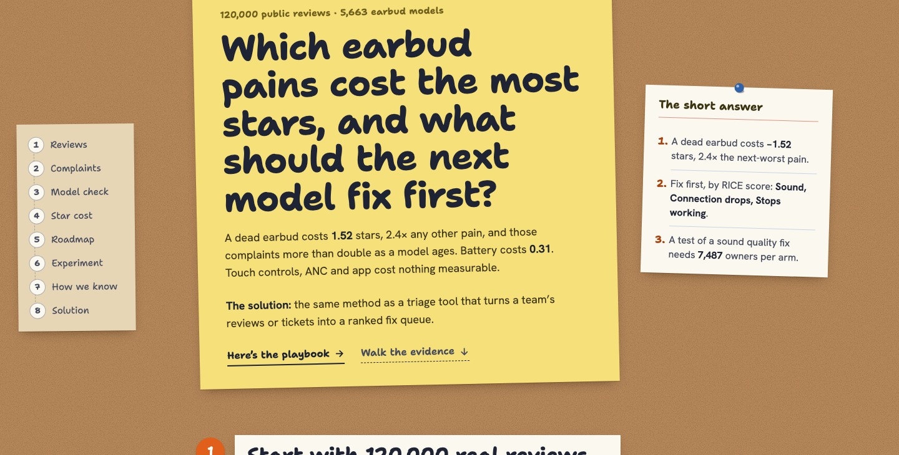
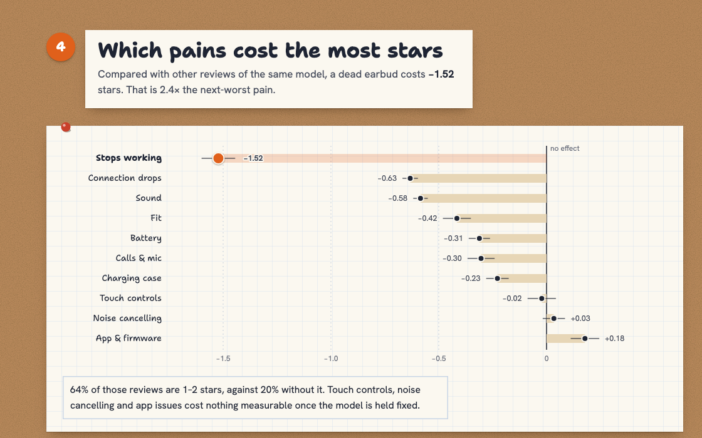
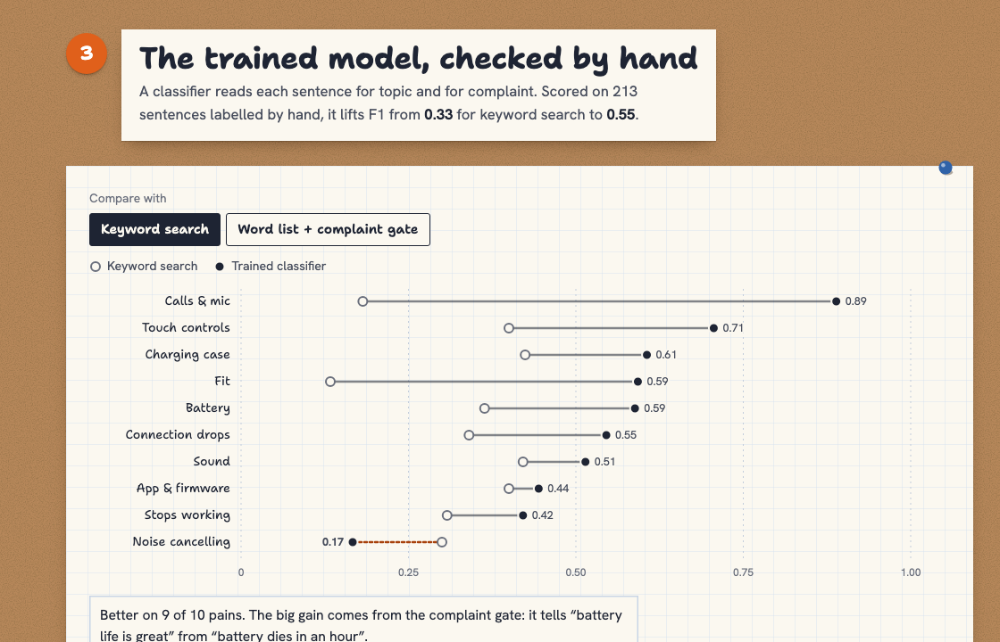
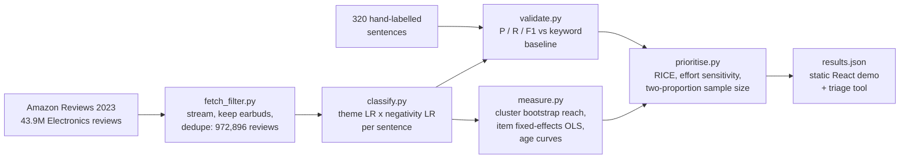
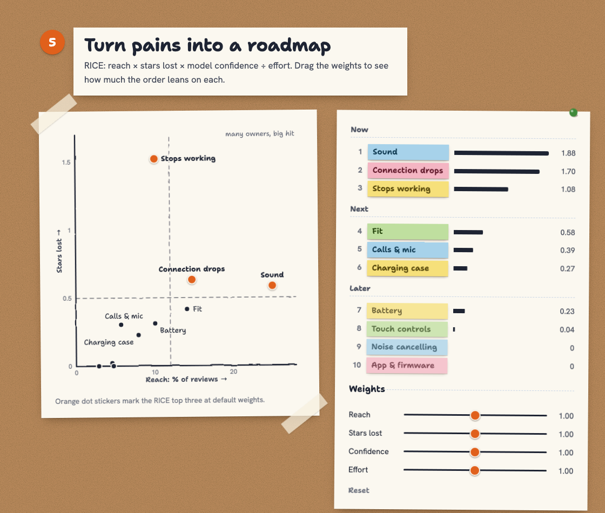

# Earbud Pain-to-Roadmap

**What true-wireless earbud owners complain about, what each complaint costs in stars, and what the next model should fix first. Measured on 120,000 public reviews.**

[](tests/)
[](LICENSE)
[-8a6d3b)](https://amazon-reviews-2023.github.io/)
[](requirements.txt)
[](package.json)

**[Live demo](https://ibiraheel.com/demos/earbud-pain-roadmap/)** · [Method](METHOD.md) · [Solution playbook](SOLUTION.md)

[](https://ibiraheel.com/demos/earbud-pain-roadmap/)

## The question

Which pains cost wireless earbuds the most stars, which ones grow as a model ages, and what should the next model fix first?

## The answer

An earbud that **stops working costs 1.52 stars** compared with other reviews of the same model. That is 2.4 times the next-worst pain. Those complaints more than double as a model ages, from 5.9% of reviews in its first 3 months to 13.6% after 2 years. Battery costs 0.31 stars. Touch controls, noise cancelling and the app cost nothing measurable once the model is held fixed.

## The solution

A one-page field-pain triage recipe and a tool that runs it on a team's own reviews or support tickets. It returns a ranked fix queue with a decision label for every pain (FIX FIRST, GATE BEFORE LAUNCH, WATCH, NON-GOAL) and a sized test for each fix. The recipe, the decision rules and a week-one plan are in **[SOLUTION.md](SOLUTION.md)**.

```bash
.venv/bin/python -I run.py triage reviews.jsonl --out triage/
```

## Key results

| Measure | Result |
|---|---|
| Data | 120,000 reviews of 5,663 earbud models (612,234 sentences), sampled from 972,896 cleaned reviews |
| Stars lost when the earbud stops working | **-1.52** (95% CI -1.60 to -1.45), 2.4x connection drops (-0.63) |
| Low-star share of those reviews | 64% are 1-2 stars, against 20% without the complaint |
| Failure complaints by model age | 5.9% at 0-3 months, 13.6% at 24+ months (2.3x) |
| Stated time to failure | median 2 months (n = 2,676 reviews that give one) |
| Battery | -0.31 stars (95% CI -0.36 to -0.26) |
| RICE top 3 | sound quality 1.88, connection drops 1.70, stops working 1.08 |
| Top-3 stability over 5,000 effort draws | 99.5%, 98.2%, 83.6% |
| Test size for the top fix (sound quality) | 7,487 owners per arm by hand, 7,488 by statsmodels |
| No measurable star cost | touch controls -0.02 (CI -0.09 to +0.04), noise cancelling +0.03 (CI -0.02 to +0.08), app +0.18 (CI +0.11 to +0.24) |

Every number comes from [`public/results.json`](public/results.json), written by the pipeline. Effort and the 50% fix efficacy are the only typed-in values, and both are labelled as assumptions.



## AI vs baseline

Each sentence goes through a theme classifier (logistic regression on TF-IDF) gated by a negativity model trained on 1-star against 5-star sentences. It is scored on 213 hand-labelled test sentences that played no part in training or tuning.

| Detector | Precision | Recall | F1 | Verdict |
|---|---|---|---|---|
| Keyword search (baseline) | 0.30 | 0.38 | 0.33 | |
| **Theme classifier x negativity (shipped)** | 0.53 | 0.58 | **0.55** | **Win** over keyword search, better on 9 of 10 themes |
| Seed lexicon x negativity | 0.58 | 0.64 | 0.61 | **Loss** for the shipped model on test |

The classifier was chosen on the dev split (F1 0.554 against 0.531) and the choice was not revisited after seeing test scores. On test, the simpler lexicon with the same negativity gate scored higher; with about 200 sentences that gap is inside noise. The negativity gate does the most work: it lifts precision from 0.37 to 0.58. Noise cancelling is the one theme where the classifier loses to keywords (F1 0.17 against 0.30, on 4 test positives). Per-theme F1 is the Confidence term in RICE, so weakly validated themes are discounted automatically.



## How it works



- **Reach** is the share of reviews with each pain, with a 95% CI from a bootstrap that resamples whole models.
- **Stars lost** comes from OLS with item fixed effects and item-clustered errors, so a model's overall rating level is held fixed and only the complaint's own effect remains.
- **RICE** is reach x stars lost x detector F1 / effort. Effort is perturbed log-uniformly in [0.5x, 2x] over 5,000 draws to show how much the order leans on it.
- **Test size** is a two-proportion z-test, checked by hand and against statsmodels.



Equations, assumptions and validation are in [METHOD.md](METHOD.md).

## Quickstart

Python 3.10+ and Node 18+.

```bash
# 1. Environment
python -m venv .venv && .venv/bin/pip install -r requirements.txt

# 2. Tests (16 run on a fresh clone; 2 more run once the data below is downloaded)
.venv/bin/python -I -m pytest -q tests

# 3. Full pipeline (streams about 28 GB from Hugging Face, keeps only the earbud subset)
D=../_downloads/earbud-pain-roadmap && mkdir -p $D
B=https://huggingface.co/datasets/McAuley-Lab/Amazon-Reviews-2023/resolve/main/raw
curl -sL $B/meta_categories/meta_Electronics.jsonl | .venv/bin/python -I pipeline/fetch_filter.py meta $D
curl -sL $B/review_categories/Electronics.jsonl    | .venv/bin/python -I pipeline/fetch_filter.py reviews $D
.venv/bin/python -I run.py score  $D      # classify sentences, cache scored.pkl
.venv/bin/python -I run.py export $D      # write public/results.json

# 4. Triage tool, on the cached public scoring (seconds) or on your own JSONL export
.venv/bin/python -I run.py triage $D/interim/scored.pkl --out triage/
.venv/bin/python -I run.py triage reviews.jsonl --effort effort.json --out triage/

# 5. Demo
npm install
npm run dev                          # http://localhost:5173/demos/earbud-pain-roadmap/
npm run build                        # dist/, built for /demos/earbud-pain-roadmap/
VITE_BASE=/ npm run build            # or for hosting at a domain root
```

The demo reads only `public/results.json`, so it runs with no API keys and no backend. The tests look for the download in `../_downloads/earbud-pain-roadmap`; set `EARBUD_RAW` to point elsewhere.

## Repo layout

```
pipeline/          fetch_filter, classify, measure, prioritise, assemble, triage, validate
tests/             estimator checks, results consistency, triage end to end
data/              hand_labels.csv (review keys and labels, no review text)
public/            results.json, the only file the demo reads
src/               React + TypeScript demo
docs/img/          screenshots
run.py             entry point: score | sample | export | triage
METHOD.md          equations, assumptions, validation, limitations
SOLUTION.md        triage recipe, decision rules, week-one plan
PRODUCT_SPEC.md    one-page spec the numbers support
```

## Data

[Amazon Reviews 2023](https://amazon-reviews-2023.github.io/), Electronics category, McAuley Lab, UC San Diego, via the Hugging Face mirror `McAuley-Lab/Amazon-Reviews-2023`.

> Hou, Li, He, Yan, Chen, McAuley. *Bridging Language and Items for Retrieval and Recommendation.* arXiv:2403.03952, 2024.

The dataset card states no licence; it is released for research use. This repo ships only aggregate statistics (shares, coefficients, counts, frequent bigrams). No review text is committed. The hand-label file stores, for 320 sentences, the dataset's own review key (product ID, the dataset's anonymised reviewer ID and timestamp), a sentence index and a label; the text is rebuilt from a local download. Nothing is simulated. The code is MIT-licensed; that licence does not extend to the dataset.

## Limitations

- **One annotator, 320 labels.** Per-theme scores rest on 4 to 21 test positives each. A second annotator and Cohen's kappa are the next step.
- **Sound quality reach is probably overstated.** Its detector precision is 0.39, so its RICE lead over connection drops is not robust.
- **Reviews are not support tickets.** Reviewers self-select, and failures that end in a return may never be reviewed. Rates describe reviews, not owners.
- **Model age is a proxy.** "Months since the model's first review" mixes product age with owner tenure.
- **Associations, not causal effects.** Stars lost is a within-model association. Effort and fix efficacy are assumptions; the test size scales roughly with 1/efficacy².

## Author

**Ibi Raheel**, mechanical engineer building AI tools · [ibiraheel.com](https://ibiraheel.com)
